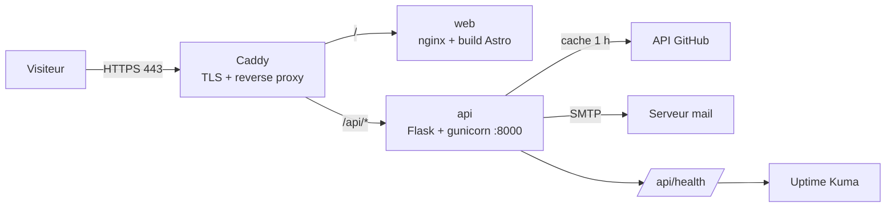

# Portfolio — Mohamed Hosayni

Portfolio professionnel bilingue (FR/EN), rapide et optimisé pour le référencement, qui met en avant le développement full-stack **et** les compétences DevOps.

[](https://github.com/hosayni/portfolio/actions/workflows/ci.yml)
[](https://github.com/hosayni/portfolio/actions/workflows/deploy.yml)
[](LICENSE)

> **État du projet :** en construction — étape 7/10 (CD : publication ghcr.io,
> déploiement SSH automatique, rollback et durcissement VPS documentés).
> La supervision et la documentation finale sont ajoutées aux étapes suivantes.

---

## Sommaire

- [Stack](#stack)
- [Architecture](#architecture)
- [Structure du dépôt](#structure-du-dépôt)
- [Démarrage local](#démarrage-local)
- [Variables d'environnement](#variables-denvironnement)
- [Qualité et CI](#qualité-et-ci)
- [Déploiement](#déploiement)
- [Feuille de route](#feuille-de-route)

## Stack

| Couche | Technologie | Rôle |
| --- | --- | --- |
| Frontend | Astro + TypeScript strict + Tailwind CSS | Site statique, SEO, i18n |
| Backend | Python 3.12 + Flask + Gunicorn | API interne (projets, contact, santé) |
| Conteneurs | Docker + Docker Compose | Images multi-stage, reproductibles |
| Reverse proxy | Caddy | HTTPS automatique (Let's Encrypt) |
| CI/CD | GitHub Actions + ghcr.io | Tests, build, publication, déploiement |
| Qualité | ESLint, Prettier, `astro check`, Ruff, Pytest, Playwright, Lighthouse CI | Garde-fous automatiques |
| Monitoring | Uptime Kuma | Disponibilité et alertes |

## Architecture

Le site public est servi statiquement ; seule l'API dynamique passe par Flask.
Caddy termine le TLS et route selon le préfixe d'URL.



Principes :

- **Un seul point d'entrée public** (Caddy). Les conteneurs `web` et `api` ne publient aucun port.
- **Dégradation gracieuse** : si l'API GitHub est indisponible, le site affiche le contenu de repli statique.
- **Aucun secret dans le dépôt** : tout passe par `.env` (local) ou les secrets GitHub (production).

## Structure du dépôt

```text
portfolio/
├── web/                    # Astro : site public (layout SEO, i18n, pages)
│   ├── src/
│   │   ├── content/        # Projets, articles et pages légales (Markdown + Zod)
│   │   ├── lib/            # Accès aux collections, dates, temps de lecture
│   │   ├── components/     # Header, Footer, cartes, formulaire, schémas
│   │   ├── data/           # Compétences, parcours, navigation
│   │   └── pages/[lang]/   # Routes FR/EN générées à partir des collections
│   ├── nginx/              # Configuration nginx non-root (cache, en-têtes)
│   └── Dockerfile          # Build Node → image statique nginx
├── api/                    # Flask : santé, dépôts GitHub (cache), contact SMTP
│   ├── app/                # factory, routes, services, validation, logs JSON
│   ├── tests/              # Pytest (GitHub et SMTP simulés)
│   ├── Dockerfile          # venv → image Gunicorn non-root
│   └── wsgi.py             # point d'entrée Gunicorn
├── deploy/                 # Compose de production, Caddyfile, .env.example
├── docs/
│   ├── adr/                # Journal des décisions d'architecture
│   ├── CI.md               # Workflow CI, seuils et politique de sécurité
│   └── DEPLOIEMENT.md      # Mise en production (base, complétée étape 7/10)
├── .github/
│   ├── workflows/ci.yml    # lint, tests, e2e, Lighthouse, sécurité, CodeQL
│   ├── scripts/            # vérification npm audit avec exceptions datées
│   ├── security/           # liste des exceptions npm, justifiées
│   └── dependabot.yml      # mises à jour npm, pip, Docker, actions
├── HISTORIQUE.md           # Journal local de construction, étape par étape
├── .env.example            # Variables attendues (aucune valeur réelle)
├── .editorconfig
├── .gitattributes
├── .gitignore
└── README.md
```

## Démarrage local

### Frontend Astro (disponible)

Prérequis : Node 22 (`nvm use`) et npm 10+.

```bash
cd web
npm ci
npm run dev
```

Le site est servi sur <http://localhost:4321> et redirige vers `/fr/` ;
`/en/` sert la version anglaise. En développement, Vite relaie `/api/*` vers
Flask (`http://localhost:8000` par défaut) : lancer l'API en parallèle pour le
formulaire de contact et la liste des dépôts GitHub.

| Commande | Rôle |
| --- | --- |
| `npm run dev` | Serveur de développement avec rechargement |
| `npm run build` | Build statique dans `web/dist/` |
| `npm run preview` | Sert le build local |
| `npm run check` | Vérification TypeScript et Astro |
| `npm run lint` | ESLint |
| `npm run test:e2e` | Tests Playwright sur le build (`astro preview`) |
| `npm run format` | Prettier (écriture) |

Les tests de bout en bout nécessitent un build et Chromium :

```bash
npx playwright install chromium   # une seule fois
npm run build
npm run test:e2e
```

### API Flask (disponible)

Prérequis : Python 3.12+ et un serveur SMTP pour les envois réels (facultatif en
développement, où les e-mails sont seulement journalisés).

```bash
cd api
python3 -m venv .venv
.venv/bin/pip install -r requirements-dev.txt
.venv/bin/flask --app wsgi run --port 8000
```

| Commande | Rôle |
| --- | --- |
| `flask --app wsgi run --port 8000` | API locale |
| `.venv/bin/pytest` | Tests et couverture (seuil 80 %) |
| `.venv/bin/ruff check .` | Lint Python |
| `.venv/bin/ruff format --check .` | Format Python |

Détails, endpoints et limites : [`api/README.md`](api/README.md).

### Stack complète (Docker, recommandée)

Prérequis : Docker 24+ et Docker Compose v2.24+. Aucun Node ni Python local n'est
nécessaire.

```bash
git clone git@github.com:hosayni/portfolio.git
cd portfolio
cp .env.example .env      # facultatif ; nécessaire pour GitHub/SMTP réels
docker compose up --build
```

`docker-compose.yml` construit les cibles de développement :

- **web** : Astro avec rechargement à chaud ; les sources sont montées et Vite
  relaie `/api` vers le service Flask.
- **api** : Flask en mode debug avec rechargement à chaud ; `/api/health` sert
  de healthcheck.
- Les deux services ne sont publiés que sur `127.0.0.1`.

| Service | URL locale |
| --- | --- |
| Site | <http://localhost:4321> |
| API | <http://localhost:8000/api/health> |

Le frontend appelle `/api/health/` (slash final) : c'est le chemin utilisé par
le proxy de développement et par Caddy en production.

```bash
docker compose down       # arrêt
docker compose down -v    # arrêt + suppression du volume node_modules
```

### Images de production

Les Dockerfiles exposent une cible `runtime` : nginx non-root pour Astro,
Gunicorn non-root pour Flask, avec `HEALTHCHECK`. Les images de production sont
publiées sur `ghcr.io` et orchestrées par
[`deploy/docker-compose.prod.yml`](deploy/docker-compose.prod.yml) : Caddy sur
80/443, réseau privé, limites de ressources et systèmes de fichiers en lecture
seule. La publication et le déploiement SSH sont traités à l'étape 7.

## Variables d'environnement

Toutes les variables de développement sont documentées dans
[`.env.example`](.env.example). La production utilise un modèle séparé,
[`deploy/.env.example`](deploy/.env.example), à copier en `deploy/.env` avec des
permissions `600`. Les plus sensibles :

| Variable | Usage | Obligatoire |
| --- | --- | --- |
| `SECRET_KEY` | Signature Flask | Oui (production) |
| `GITHUB_TOKEN` | Lecture des dépôts, évite le quota anonyme | Recommandé |
| `SMTP_*` | Envoi des messages du formulaire | Oui (contact) |
| `CORS_ORIGINS` | Domaines autorisés à appeler l'API | Oui |

Le fichier `.env` n'est **jamais** versionné. En production il est créé sur le VPS
avec des permissions `600`.

## Qualité et CI

Chaque pull request et chaque push hors `main` déclenche
[`ci.yml`](.github/workflows/ci.yml), avec six jobs :

| Job | Vérifications |
| --- | --- |
| `web` | npm ci, Prettier, ESLint, `astro check`, build, artefact `web-dist` |
| `e2e` | Playwright sur le build : redirection FR, langue, filtre projets, formulaire |
| `lighthouse` | performance, accessibilité, bonnes pratiques et SEO sur `/fr/` et `/en/` |
| `api` | Ruff, format, Pytest et couverture ≥ 80 % |
| `security` | `npm audit` filtré par exceptions datées, `pip-audit --strict` |
| `codeql` | analyse statique JavaScript/TypeScript et Python |

Les seuils Lighthouse sont bloquants à **95** pour l'accessibilité, les bonnes
pratiques et le SEO. La performance est mesurée sur mobile, cinq fois par page,
et deviendra bloquante à 95 à l'étape 8, après optimisation sur le runner dédié.
Les exceptions npm (Astro 5 imposé) sont justifiées et expirent le 31 mars 2027.
Dépendances, seuils et protection de branche sont détaillés dans
[`docs/CI.md`](docs/CI.md).

Dependabot surveille npm, pip, Docker, les Compose et les actions GitHub une
fois par semaine. La branche `main` doit être protégée : PR obligatoire, CI
verte et branches à jour avant fusion.

## Déploiement

Le Compose de production, le Caddyfile et le workflow CD sont prêts (étape 7).
La procédure complète de mise en production, de publication `ghcr.io`, de
déploiement SSH, de durcissement VPS et de rollback est documentée dans
[`docs/DEPLOIEMENT.md`](docs/DEPLOIEMENT.md). En résumé : push sur `main` → CI →
images publiées sur `ghcr.io` → déploiement sur le VPS → healthcheck → rollback
automatique en cas d'échec.

## Feuille de route

- [x] **1. Initialisation** — dépôt, conventions, structure, documentation de départ
- [x] **2. Frontend** — Astro 5, TypeScript strict, Tailwind, layout SEO, i18n FR/EN, thème
- [x] **3. Pages et contenu** — collections Astro, projets détaillés, compétences, parcours, blog, contact, pages légales
- [x] **4. API Flask** — endpoint santé, projets GitHub avec cache, contact validé et limité
- [x] **5. Docker** — images multi-stage non-root, nginx, Compose de développement et de production
- [x] **6. CI** — GitHub Actions, Playwright, Lighthouse CI, audits de sécurité, CodeQL, Dependabot
- [x] **7. CD et VPS** — publication ghcr.io, déploiement, Caddy, durcissement
- [ ] **8. SEO et performance** — JSON-LD, sitemap, RSS, Lighthouse ≥ 95
- [ ] **9. Monitoring** — Uptime Kuma, healthchecks, alertes
- [ ] **10. Documentation** — guide de déploiement, checklist de livraison

## Licence

[MIT](LICENSE) — le contenu rédactionnel (textes, images) reste la propriété de
Mohamed Hosayni.
