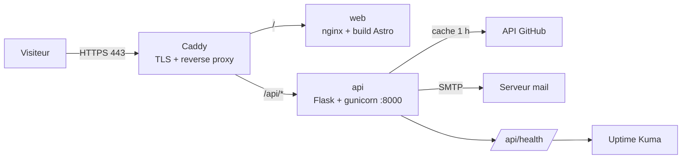

# Portfolio — Mohamed Hosayni

Portfolio professionnel bilingue (FR/EN), rapide et optimisé pour le référencement, qui met en avant le développement full-stack **et** les compétences DevOps.

[](https://github.com/hosayni/portfolio/actions/workflows/ci.yml)
[](https://github.com/hosayni/portfolio/actions/workflows/deploy.yml)
[](LICENSE)

> **État du projet :** en construction — étape 2/10 (base Astro, layout SEO, i18n FR/EN).
> Le site public, l'API et le déploiement sont ajoutés aux étapes suivantes (voir la [feuille de route](#feuille-de-route)).

---

## Sommaire

- [Stack](#stack)
- [Architecture](#architecture)
- [Structure du dépôt](#structure-du-dépôt)
- [Démarrage local](#démarrage-local)
- [Variables d'environnement](#variables-denvironnement)
- [Qualité et CI](#qualité-et-ci)
- [Déploiement](#déploiement)
- [Feuille de route](#feuille-de-route)

## Stack

| Couche | Technologie | Rôle |
| --- | --- | --- |
| Frontend | Astro + TypeScript strict + Tailwind CSS | Site statique, SEO, i18n |
| Backend | Python 3.12 + Flask + Gunicorn | API interne (projets, contact, santé) |
| Conteneurs | Docker + Docker Compose | Images multi-stage, reproductibles |
| Reverse proxy | Caddy | HTTPS automatique (Let's Encrypt) |
| CI/CD | GitHub Actions + ghcr.io | Tests, build, publication, déploiement |
| Qualité | ESLint, Prettier, `astro check`, Ruff, Pytest, Playwright, Lighthouse CI | Garde-fous automatiques |
| Monitoring | Uptime Kuma | Disponibilité et alertes |

## Architecture

Le site public est servi statiquement ; seule l'API dynamique passe par Flask.
Caddy termine le TLS et route selon le préfixe d'URL.



Principes :

- **Un seul point d'entrée public** (Caddy). Les conteneurs `web` et `api` ne publient aucun port.
- **Dégradation gracieuse** : si l'API GitHub est indisponible, le site affiche le contenu de repli statique.
- **Aucun secret dans le dépôt** : tout passe par `.env` (local) ou les secrets GitHub (production).

## Structure du dépôt

```text
portfolio/
├── web/                    # Astro : site public (layout SEO, i18n, pages)
├── api/                    # Flask : API interne (à venir, étape 4)
├── deploy/                 # Compose de production, Caddyfile (étape 7)
├── docs/
│   ├── adr/                # Journal des décisions d'architecture
│   └── DEPLOIEMENT.md      # Procédure de mise en production (étape 10)
├── .github/workflows/      # CI et CD (étapes 6 et 7)
├── .env.example            # Variables attendues (aucune valeur réelle)
├── .editorconfig
├── .gitattributes
├── .gitignore
└── README.md
```

## Démarrage local

### Frontend Astro (disponible)

Prérequis : Node 22 (`nvm use`) et npm 10+.

```bash
cd web
npm ci
npm run dev
```

Le site est servi sur <http://localhost:4321> et redirige vers `/fr/` ;
`/en/` sert la version anglaise.

| Commande | Rôle |
| --- | --- |
| `npm run dev` | Serveur de développement avec rechargement |
| `npm run build` | Build statique dans `web/dist/` |
| `npm run preview` | Sert le build local |
| `npm run check` | Vérification TypeScript et Astro |
| `npm run lint` | ESLint |
| `npm run format` | Prettier (écriture) |

### Stack complète (Docker)

> Disponible à partir de l'étape 5 (Dockerisation). Les commandes ci-dessous seront
> alors la référence unique pour lancer le projet.

Prérequis : Docker 24+, Docker Compose v2.

```bash
git clone git@github.com:hosayni/portfolio.git
cd portfolio
cp .env.example .env      # puis renseigner les valeurs
docker compose up --build
```

| Service | URL locale |
| --- | --- |
| Site | <http://localhost:4321> |
| API | <http://localhost:8000/api/health> |

## Variables d'environnement

Toutes les variables sont documentées dans [`.env.example`](.env.example).
Les plus sensibles :

| Variable | Usage | Obligatoire |
| --- | --- | --- |
| `SECRET_KEY` | Signature Flask | Oui (production) |
| `GITHUB_TOKEN` | Lecture des dépôts, évite le quota anonyme | Recommandé |
| `SMTP_*` | Envoi des messages du formulaire | Oui (contact) |
| `CORS_ORIGINS` | Domaines autorisés à appeler l'API | Oui |

Le fichier `.env` n'est **jamais** versionné. En production il est créé sur le VPS
avec des permissions `600`.

## Qualité et CI

Chaque pull request déclenche : lint et build du frontend, `astro check`, tests
Playwright, Ruff et Pytest avec couverture, Lighthouse CI et analyse de sécurité.
La branche `main` est protégée : PR obligatoire et CI verte.

## Déploiement

Procédure détaillée à l'étape 7/10 : [`docs/DEPLOIEMENT.md`](docs/DEPLOIEMENT.md).
En résumé : push sur `main` → CI → images publiées sur `ghcr.io` → déploiement SSH
sur le VPS → healthcheck → rollback automatique en cas d'échec.

## Feuille de route

- [x] **1. Initialisation** — dépôt, conventions, structure, documentation de départ
- [x] **2. Frontend** — Astro 5, TypeScript strict, Tailwind, layout SEO, i18n FR/EN, thème
- [ ] **3. Pages et contenu** — accueil, projets, compétences, parcours, blog, contact, pages légales
- [ ] **4. API Flask** — endpoint santé, projets GitHub avec cache, contact validé et limité
- [ ] **5. Docker** — images multi-stage, nginx, Compose de développement
- [ ] **6. CI** — workflows, Dependabot, revue de PR
- [ ] **7. CD et VPS** — publication ghcr.io, déploiement, Caddy, durcissement
- [ ] **8. SEO et performance** — JSON-LD, sitemap, RSS, Lighthouse ≥ 95
- [ ] **9. Monitoring** — Uptime Kuma, healthchecks, alertes
- [ ] **10. Documentation** — guide de déploiement, checklist de livraison

## Licence

[MIT](LICENSE) — le contenu rédactionnel (textes, images) reste la propriété de
Mohamed Hosayni.
