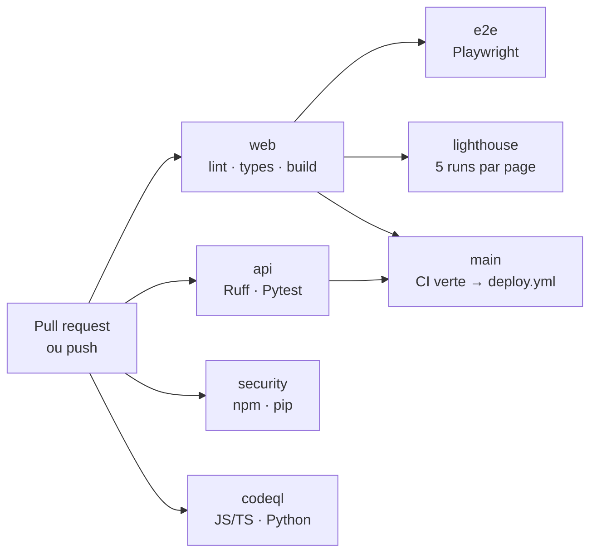

# Intégration continue (CI)

Le workflow [`.github/workflows/ci.yml`](../.github/workflows/ci.yml) vérifie
chaque pull request et chaque push, y compris sur `main`. Le déploiement est
traité par `deploy.yml` à l'étape 7, qui attend une CI verte sur `main`.



## Déclencheurs et concurrence

- `pull_request` : toutes les PR, y compris les mises à jour Dependabot.
- `push` : toutes les branches, y compris `main`, pour valider le commit
  fusionné avant déploiement.
- `workflow_dispatch` : relance manuelle possible.
- `concurrency` : une nouvelle exécution sur la même référence annule la
  précédente ; inutile de tester un commit déjà obsolète.
- Permissions par défaut : `contents: read` uniquement. Le job CodeQL demande
  explicitement `security-events: write` pour publier ses résultats.
- `deploy.yml` se déclenche par `workflow_run` après une CI verte sur `main`.

## Jobs

| Job | Durée indicative | Contenu |
| --- | --- | --- |
| `web` | 3–5 min | `npm ci`, Prettier, ESLint, `astro check`, build, artefact `web-dist` |
| `e2e` | 4–6 min | Chromium + Playwright sur le build du job `web` |
| `lighthouse` | 5–8 min | Lighthouse CI sur `/fr/` et `/en/`, 5 runs par page |
| `api` | 1–2 min | Ruff, format, Pytest avec seuil de couverture 80 % |
| `security` | 1–2 min | `npm audit` filtré, `pip-audit --strict` |
| `codeql` | 3–6 min | Analyse CodeQL `javascript-typescript` et `python` |

`web`, `api`, `security` et `codeql` démarrent en parallèle. `e2e` et
`lighthouse` attendent le build validé par `web` : ils ne reconstruisent pas le
site et testent exactement l'artefact produit.

Les dépendances sont mises en cache par `actions/setup-node` (cache npm) et
`actions/setup-python` (cache pip). Les rapports Playwright et Lighthouse ne
sont conservés qu'en cas d'échec ou pour analyse, pendant 7 jours.

## Reproduire la CI en local

### Frontend

```bash
cd web
npm ci
npm run format:check
npm run lint
npm run check
npm run build

# Une seule fois par machine :
npx playwright install chromium
npm run test:e2e

# Lighthouse CI (Chrome doit être installé) :
CHROME_PATH=/usr/bin/google-chrome npx --yes @lhci/cli@0.15.1 autorun
```

`npm run test:e2e` démarre `astro preview` sur le port 4321 et teste le contenu
de `dist/`. Aucune API Flask n'est nécessaire : les tests couvrent la
redirection FR, le changement de langue, le filtre projets et la validation du
formulaire.

### API

```bash
cd api
python3 -m venv .venv
.venv/bin/pip install -r requirements-dev.txt
.venv/bin/ruff check .
.venv/bin/ruff format --check .
.venv/bin/pytest
```

### Sécurité

```bash
# npm : générer l'audit puis appliquer la politique d'exceptions
cd web
npm audit --json > /tmp/npm-audit.json || true
node ../.github/scripts/check-npm-audit.mjs \
  /tmp/npm-audit.json ../.github/security/npm-audit-allowlist.json

# Python
cd ../api
.venv/bin/pip-audit -r requirements.txt --progress-spinner off --strict
```

## Seuils Lighthouse

| Catégorie | Seuil | Statut |
| --- | --- | --- |
| Accessibilité | 95 | **bloquant** |
| Bonnes pratiques | 95 | **bloquant** |
| SEO | 95 | **bloquant** |
| Performance | 95 | **bloquant** (depuis l'étape 8) |

La performance est mesurée sur mobile avec la limitation CPU par défaut de
Lighthouse (×4), cinq fois par page, puis agrégée par médiane. Elle est
**bloquante à 95** depuis l'étape 8. Les résultats restent sensibles à la
charge de la machine de mesure ; le runner GitHub dédié sert de référence.

Les rapports sont écrits dans `web/.lighthouseci/` et publiés comme artefact.
Aucun envoi vers un stockage public externe n'est effectué.

## Sécurité des dépendances

### npm : exceptions datées

`npm audit` signale des avis dans l'arbre Astro 5. La demande impose Astro 5,
alors que les correctifs correspondants ne sont publiés que pour Astro 6/7 et
des versions plus récentes de `sharp` et `zod`.

Pour ne pas bloquer la CI sans masquer le problème, le script
[`check-npm-audit.mjs`](../.github/scripts/check-npm-audit.mjs) applique une
politique stricte :

- toute vulnérabilité **haute** ou **critique** non listée fait échouer le job ;
- une exception expirée, dont la gravité a changé ou devenue inutile est
  signalée ;
- les vulnérabilités basses et modérées sont visibles dans les logs sans
  bloquer.

Les exceptions et leur justification sont dans
[`npm-audit-allowlist.json`](../.github/security/npm-audit-allowlist.json) et
expirent le **31 mars 2027**. Elles reposent sur le fait que le site est
entièrement statique : aucune entrée utilisateur n'est rendue, aucune image
distante n'est optimisée à l'exécution, les slots sont définis dans le dépôt et
le serveur de développement n'est jamais exposé en production.

Avant l'expiration : mettre à jour Astro vers une version corrigée, ou
renouveler l'exception après une nouvelle analyse de risque. Ne jamais ajouter
une exception sans justification ni date.

### Python

`pip-audit -r api/requirements.txt --strict` bloque sur toute vulnérabilité
connue et sur une dépendance non résolue. Au moment de la mise en place, aucune
vulnérabilité n'est signalée.

### CodeQL

Analyse `security-and-quality` sur JavaScript/TypeScript et Python, sans
compilation (`build-mode: none`). Les résultats sont publiés dans l'onglet
**Security → Code scanning** du dépôt. Aucune installation de dépendances n'est
nécessaire, ce qui réduit la durée et la surface du job.

## Dependabot

[`.github/dependabot.yml`](../.github/dependabot.yml) surveille :

- npm (`/web`) ;
- pip (`/api`) ;
- les images Docker de `web/` et `api/` ;
- les Compose de développement (`/`) et de production (`/deploy`) ;
- les actions GitHub.

Les mises à jour arrivent une fois par semaine, groupées par écosystème. Les
montées de version **majeures d'Astro et des intégrations `@astrojs/*` sont
volontairement ignorées** : Astro 5 est une contrainte du cahier des charges,
une migration doit être décidée et testée explicitement. Les alertes de
sécurité restent visibles dans l'onglet Security.

## Protection de la branche `main`

À configurer une fois dans **Settings → Branches → Add branch protection rule**
(pattern `main`) :

- [ ] Require a pull request before merging ;
- [ ] Require approvals (1, ou 0 en solo avec relecture personnelle) ;
- [ ] Require status checks to pass before merging :
  - `web`
  - `e2e`
  - `lighthouse`
  - `api`
  - `security`
  - `codeql (javascript-typescript)`
  - `codeql (python)`
- [ ] Require branches to be up to date before merging ;
- [ ] Block force pushes et suppressions de branche ;
- [ ] Do not allow bypassing the above settings (admins inclus) ;
- [ ] Require conversation resolution avant fusion.

Activer également dans **Settings → Code security** : Dependabot alerts,
Dependabot security updates, secret scanning et push protection. Aucun secret
n'est requis par la CI ; les secrets de déploiement seront créés à l'étape 7.

## Limites assumées

- La CI ne déploie pas : `deploy.yml` arrive à l'étape 7.
- Playwright ne couvre que Chromium ; Firefox/WebKit pourront être ajoutés si le
  temps de CI le permet.
- Lighthouse teste le build statique servi par son propre serveur, sans Caddy,
  TLS ni API. Les mesures de production (HTTPS, cache, compression) seront
  faites aux étapes 8 et 9.
- Les exceptions npm sont temporaires par construction : la date d'expiration
  force une revue.
