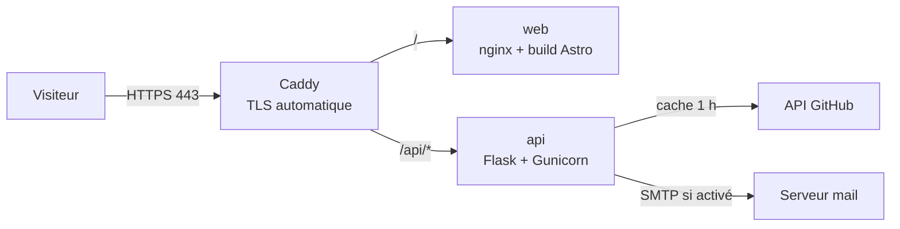

# Déploiement

Mise en production du portfolio sur le VPS `5.189.129.87` (Ubuntu 24.04,
Docker déjà installé), domaine `hosayni.com` et `www.hosayni.com`. Le dépôt
n'est **jamais** cloné sur le VPS : seuls les artefacts nécessaires
(`docker-compose.prod.yml`, `Caddyfile`, `deploy.sh`) y sont copiés par le
workflow.

## Architecture de production



- Seul Caddy publie des ports (`80`, `443`). `web` et `api` restent sur le
  réseau Docker privé.
- Les images sont tirées de `ghcr.io/hosayni/portfolio-{web,api}:sha-<commit>`.
- Le TLS est géré par Caddy (Let's Encrypt) ; aucun certificat n'est stocké
  dans le dépôt.

## 0. Prérequis

- DNS : enregistrements `A` pour `@` et `www` vers `5.189.129.87`.
- VPS : utilisateur `deploy` avec accès SSH par clé et appartenance au groupe
  `docker`.
- Compte GitHub : dépôt `hosayni/portfolio`, secrets et environnement
  `production` configurés (voir § 4).
- Aucun SMTP requis pour la première mise en ligne (`CONTACT_ENABLED=false`).

## 1. DNS

Chez le registrar :

```text
A    @      5.189.129.87
A    www    5.189.129.87
```

Vérification :

```bash
dig +short hosayni.com
dig +short www.hosayni.com
```

Les deux doivent renvoyer `5.189.129.87`. Attendre la propagation (TTL) avant
de lancer le premier déploiement.

## 2. Durcissement du VPS

À exécuter en SSH en tant qu'administrateur (`sudo`), une seule fois.

### 2.1 Utilisateur `deploy`

```bash
id deploy
sudo usermod -aG docker deploy
# se reconnecter pour prendre le groupe
ssh deploy@5.189.129.87 'docker version --format "{{.Server.Version}}"'
```

### 2.2 Clé SSH dédiée à GitHub Actions

Sur la machine qui gère le dépôt (ou le VPS) :

```bash
ssh-keygen -t ed25519 -C "github-actions-portfolio" -f ~/.ssh/portfolio_deploy
ssh-copy-id -i ~/.ssh/portfolio_deploy.pub deploy@5.189.129.87
```

Le contenu de `~/.ssh/portfolio_deploy` (clé privée) ira dans le secret
`VPS_SSH_KEY`. L'empreinte du serveur, pour `VPS_KNOWN_HOSTS` :

```bash
ssh-keyscan -H 5.189.129.87
```

### 2.3 SSH durci

Créer `/etc/ssh/sshd_config.d/99-portfolio.conf` :

```text
PasswordAuthentication no
PermitRootLogin no
PubkeyAuthentication yes
X11Forwarding no
```

```bash
sudo sshd -t && sudo systemctl reload ssh
```

### 2.4 Pare-feu et services

```bash
sudo ufw default deny incoming
sudo ufw default allow outgoing
sudo ufw allow 22/tcp
sudo ufw allow 80/tcp
sudo ufw allow 443/tcp
sudo ufw allow 443/udp
sudo ufw enable
sudo ufw status verbose
```

Notes :

- Docker publie ses ports via iptables ; en production **seuls** Caddy
  (`80`/`443`) sont publiés, donc le pare-feu reste cohérent.
- Fail2ban et les mises à jour automatiques sont recommandés :

```bash
sudo apt update
sudo apt install -y fail2ban unattended-upgrades
sudo dpkg-reconfigure -plow unattended-upgrades
```

## 3. Répertoire de production et `.env`

```bash
sudo install -d -o deploy -g deploy -m 750 /opt/portfolio
scp deploy/.env.example deploy@5.189.129.87:/opt/portfolio/.env
ssh deploy@5.189.129.87 'chmod 600 /opt/portfolio/.env'
```

Éditer `/opt/portfolio/.env` sur le VPS et renseigner au minimum :

```text
SITE_DOMAIN=hosayni.com
WWW_DOMAIN=www.hosayni.com
ACME_EMAIL=hosayni92@gmail.com
GHCR_OWNER=hosayni
IMAGE_TAG=latest
APP_ENV=production
APP_VERSION=0.1.0
LOG_LEVEL=INFO
SECRET_KEY=<généré avec openssl rand -base64 48>
SITE_URL=https://hosayni.com
SITE_NAME=Mohamed Hosayni
CORS_ORIGINS=https://hosayni.com,https://www.hosayni.com
CONTACT_RATE_LIMIT=5 per hour
RATELIMIT_STORAGE_URI=memory://
RATELIMIT_ENABLED=true
TRUST_PROXY=true
GITHUB_USERNAME=hosayni
GITHUB_TOKEN=
GITHUB_CACHE_TTL=3600
GITHUB_MAX_REPOS=6
GITHUB_REPOS=
GITHUB_HTTP_TIMEOUT=5
CONTACT_ENABLED=false
SMTP_HOST=
SMTP_PORT=587
SMTP_USER=
SMTP_PASSWORD=
SMTP_USE_TLS=true
SMTP_TIMEOUT=10
SMTP_FROM=no-reply@hosayni.com
CONTACT_TO=hosayni92@gmail.com
MAIL_SUPPRESS_SEND=false
```

Générer la clé Flask :

```bash
python3 -c "import secrets; print(secrets.token_urlsafe(48))"
```

Vérifier les permissions :

```bash
ssh deploy@5.189.129.87 'stat -c "%a %U:%G %n" /opt/portfolio/.env'
# attendu : 600 deploy:deploy
```

## 4. Secrets et environnement GitHub

Dans **Settings → Secrets and variables → Actions** du dépôt :

| Secret | Valeur |
| --- | --- |
| `VPS_HOST` | `5.189.129.87` |
| `VPS_USER` | `deploy` |
| `VPS_SSH_KEY` | contenu de `~/.ssh/portfolio_deploy` (clé privée) |
| `VPS_KNOWN_HOSTS` | sortie de `ssh-keyscan -H 5.189.129.87` |
| `VPS_PORT` | `22` (facultatif) |

Variables (non secrètes) :

| Variable | Valeur |
| --- | --- |
| `SITE_URL` | `https://hosayni.com` |
| `GHCR_OWNER` | `hosayni` |
| `PUBLIC_CONTACT_ENABLED` | `false` tant que le SMTP n'est pas configuré |

Dans **Settings → Environments**, créer `production` avec l'URL
`https://hosayni.com`. L'approbation manuelle y est facultative (voir ADR 0003).

Appliquer aussi la protection de branche `main` selon `docs/CI.md`.

## 5. Premier déploiement

1. Fusionner la branche de travail dans `main` via une pull request verte.
2. Le workflow `CI` s'exécute sur `main`.
3. Si la CI est verte, `deploy.yml` démarre automatiquement :
   - construction et publication des images `sha-<commit>` et `latest` ;
   - authentification éphémère du VPS auprès de `ghcr.io` ;
   - copie de `docker-compose.prod.yml`, `Caddyfile`, `deploy.sh` ;
   - exécution de `deploy.sh <tag>` sur le VPS ;
   - healthcheck public puis nettoyage.
4. Vérifier :

```bash
curl -fsS https://hosayni.com/api/health/
curl -fsSI https://hosayni.com/fr/
curl -fsSI https://www.hosayni.com/
```

Le premier appel peut prendre quelques secondes (émission du certificat).
`www.hosayni.com` doit répondre `301` vers `https://hosayni.com`.

## 6. Exploitation courante

```bash
# État des conteneurs
ssh deploy@5.189.129.87 'cd /opt/portfolio && docker compose -f docker-compose.prod.yml ps'

# Logs
ssh deploy@5.189.129.87 'cd /opt/portfolio && docker compose -f docker-compose.prod.yml logs -f --tail=100'

# Redémarrer l'API
ssh deploy@5.189.129.87 'cd /opt/portfolio && docker compose -f docker-compose.prod.yml restart api'
```

Les logs sont limités par le driver `json-file` (10 Mo × 3 fichiers par
service). Les données Caddy sont conservées dans les volumes `caddy_data` et
`caddy_config`.

## 7. Rollback

### Automatique

`deploy.sh` tente un rollback vers le tag enregistré dans `.deployed-tag` si le
démarrage ou le healthcheck échoue. Aucune action manuelle n'est nécessaire.

### Manuel

```bash
ssh deploy@5.189.129.87 'cd /opt/portfolio && cat .deployed-tag'
# choisir un tag précédent, puis :
ssh deploy@5.189.129.87 'cd /opt/portfolio && bash deploy.sh sha-<commit>'
```

Le script tire l'image demandée, recrée les conteneurs et vérifie la
disponibilité.

## 8. Activer le formulaire de contact (SMTP)

Quand un SMTP est disponible :

1. Renseigner `SMTP_HOST`, `SMTP_USER`, `SMTP_PASSWORD`, `SMTP_FROM`,
   `CONTACT_TO` et `CONTACT_ENABLED=true` dans `/opt/portfolio/.env`.
2. Passer la variable GitHub `PUBLIC_CONTACT_ENABLED` à `true`.
3. Pousser un commit sur `main` (ou relancer le déploiement) pour rebuilder le
   frontend avec le formulaire visible.

`MAIL_SUPPRESS_SEND` doit rester `false` en production ; la factory refuse de
démarrer sinon.

## 9. Sauvegardes

À mettre en place à l'étape 10. Minimum vital :

```bash
# Sauvegarde des volumes Caddy (certificats et configuration)
ssh deploy@5.189.129.87 \
  'docker run --rm -v portfolio_caddy_data:/data -v /tmp:/backup alpine \
   tar czf /backup/caddy-data-$(date +%F).tar.gz -C /data .'
```

Le répertoire `/opt/portfolio/.env` doit être sauvegardé dans un gestionnaire
de secrets, jamais dans Git.

## 10. Dépannage

| Symptôme | Cause probable | Action |
| --- | --- | --- |
| `deploy/.env manquant sur le VPS` | répertoire non initialisé | recréer `/opt/portfolio/.env` (§ 3) |
| `deploy n'a pas accès à Docker` | `deploy` hors groupe `docker` | `sudo usermod -aG docker deploy`, reconnecter |
| `permission denied` sur l'image | jeton éphémère expiré | relancer le workflow ; vérifier `packages: read` |
| Caddy ne démarre pas | DNS ou variables manquantes | vérifier `SITE_DOMAIN`, `WWW_DOMAIN`, `ACME_EMAIL` |
| API unhealthy | configuration incomplète | lire `docker compose logs api` ; vérifier `.env` |
| 503 sur `/api/contact` | `CONTACT_ENABLED=false` ou SMTP absent | normal tant que le SMTP n'est pas configuré |
| Certificat non émis | DNS non propagé | attendre, puis `docker compose restart caddy` |

Les logs du dernier déploiement sont disponibles dans l'artefact GitHub Actions
et sur le VPS via `docker compose logs`.
## Reverse proxy central (Caddy + sslh)

Pour héberger plusieurs projets sur le même VPS, Caddy peut être sorti du
Compose portfolio et centralisé dans `/opt/caddy`.

### Principe

- `sslh` écoute sur `0.0.0.0:443`
- Caddy écoute sur `127.0.0.1:8444`
- les projets sont connectés au réseau Docker partagé `proxy`
- Caddy route selon le domaine

### Fichiers concernés

- `deploy/docker-compose.caddy.yml`
- `deploy/Caddyfile.central`
- `deploy/docker-compose.prod.yml` (sans Caddy, avec réseau `proxy`)

### Installation

```bash
docker network create proxy
sudo install -d -o deploy -g deploy -m 750 /opt/caddy
# copier docker-compose.caddy.yml et Caddyfile.central vers /opt/caddy
cd /opt/caddy
docker compose up -d
```

### Migration du portfolio

```bash
cd /opt/portfolio
docker compose -f docker-compose.prod.yml down
docker compose -f docker-compose.prod.yml up -d
```

### Vérification

```bash
curl -fsS https://hosayni.com/api/health/
curl -fsSI https://hosayni.com/fr/
```
